**VPP2：先把「下一个事件」预测对，动作才可能对**

> 论文：Video Prediction Policy 2: Predict Better, Act Better（arXiv 2610.10270v2，共 21 页）
> 单位：Robotera / 清华大学 / 香港科技大学（广州）/ UC Berkeley / 上海交通大学

## 一、新在哪里，证据有多硬

世界动作模型（World Action Model，WAM）这条路线赌的是：视频模型见过足够多的物理动态，把这份先验挪给机器人策略就能泛化。VPP2 的出发点是这个赌注没兑现，现有 WAM 到了没见过的场景就预测出错误的运动，动作跟着一起错。论文把病因归到两点：底座视频模型为内容观感而训练，精确物理和指令遵循从来不在目标里；而把动作组件直接塞进视频模型，又会损害它本来的泛化。

八处改动里最硬的一条是换掉预测目标，从「未来一小段」换成「一个完整操作事件」。事件的起止由子任务语义决定，一句详细指令因此只对应一种未来。全文也只有这一条做了单变量消融：换回固定时长采样，表 2 里的指令遵循成功率就从 0.80/0.90 掉到 0.48/0.42。

要让这「一种未来」真的唯一，caption 得把四类歧义全写掉：哪只末端执行器在动、用属性或空间关系唯一指出目标物体、相机视角会怎么变，以及末端与目标必须在首帧可见。

剩下两件是工程活，决定这套东西能不能真跑在机器人上。事件级模型先后训练成定长 chunk 预测，再做一致性蒸馏，单步前向就能出图，视频侧约 0.12 秒、整条动作 chunk 约 0.22 秒。动作专家以 MoT 方式挂在视频 DiT 旁边，靠注意力掩码让动作训练的梯度不回流改写视频预测。

成绩单在图 1：视频预测的指令遵循成功率 0.85，比 64B 的 Cosmos3 高 11 个百分点；真机 ALOHA 上零样本平均成功率 58.5%，π0.5 是 40.0%、Fast-WAM 是 20.5%（图 8）；针对基准后训练之后，LIBERO-Pro 45.0%、LIBERO-OOD 63.9%（表 3），RoboDojo 成功率 32.26%（表 4）。

八处改动各自在实验里的靠山，厚薄差得很远。

| 创新点 | 改了什么 | 实验里的靠山 |
|---|---|---|
| 事件级视频预测 | 预测目标从定长片段换成一个完整子任务（式 1） | 表 2 的 `VPP2-Fixed-Step` 行，全文唯一的单变量对照 |
| 详细 caption 流程 | 用模板消掉四类歧义 | 只有图 2 一个样例 |
| 跨数据集统一动作空间 | 两级刚体变换对齐坐标系（式 6） | 图 3 的定性展示 |
| 定长 chunk 后训练 + 一致性蒸馏 | 变成定长预测、单步出图（式 4、式 5） | 图 10 的定性对比 |
| MoT 动作专家 + 注意力掩码 | 0.9B 动作 DiT 并挂，梯度不回流视频侧 | 图 4 的掩码本身 |
| 冻结视频 DiT、只用 LoRA | 动作训练早期不动视频骨干 | 表 3 的整体成绩 |
| VLM 子任务规划 | 把含糊指令拆成明确子任务 | 图 9，但两个变量同时变 |
| 测试时 prompt 增强 | 指令改写成训练 caption 的样子 | 没有对应实验 |

只有事件级采样那一行把变量隔离开了，其余七处都是整条流水线一起上、一起测。论文的算力几乎全花在把系统搭成一个能跑的东西，没留给逐个组件的切除实验，所以读后面每个结论时，「到底哪一部分在起作用」这个问题都得悬着。

文中反复出现的几个词：

| 术语 | 是什么 |
|---|---|
| WAM（世界动作模型） | 先预测未来画面、再据此生成动作的策略 |
| VLA（视觉-语言-动作模型） | 从图像和指令直接输出动作，不预测未来画面 |
| action chunk | 一次推理输出的一小段连续动作；VPP2 的 chunk 覆盖 2 秒 |
| 事件级（event-level） | 以一个语义完整的子任务为单位切分视频，而非固定时长 |
| flow matching | 学习从噪声到数据的速度场，可视作扩散的连续化变体 |
| 一致性蒸馏 | 要求不同噪声水平给出一致的终点预测，把多步压成一步 |
| DiT | 以 Transformer 为骨干的扩散模型；视频侧与动作侧都是 DiT |
| MoT | 两个 Transformer 并行、在注意力层互读 token，而不是串成一条 |
| end-effector（末端执行器） | 机械臂最前端接触物体的夹爪或手；人手数据里就是手 |
| LIBERO / RoboDojo | 两个操作仿真基准；后者含 42 个双臂任务，按五维评分 |

## 二、这篇论文要解决什么问题

引言的逻辑很直：WAM 们建立在视频基座模型之上，想把物理动态先验转成策略；但已有工作发现它们只在见过的少数任务上好用，分布外就给出不可靠的运动预测，进而输出错误动作。近两年几个专门考泛化的基准把这件事量化了，在标准评测套件上接近满分的策略，一旦任务配置被扰动或技能被重新组合就大幅掉分。

作者给出的两条病因管着后面每一个设计：一是视频基座模型为创作内容和观感优化，不为精确物理和指令遵循优化；二是把动作相关的组件或训练目标引入预训练视频模型，会显著损害它的泛化能力。前者决定了必须在操作域上续训视频模型，后者决定了动作模块必须以不碰视频骨干的方式接入。

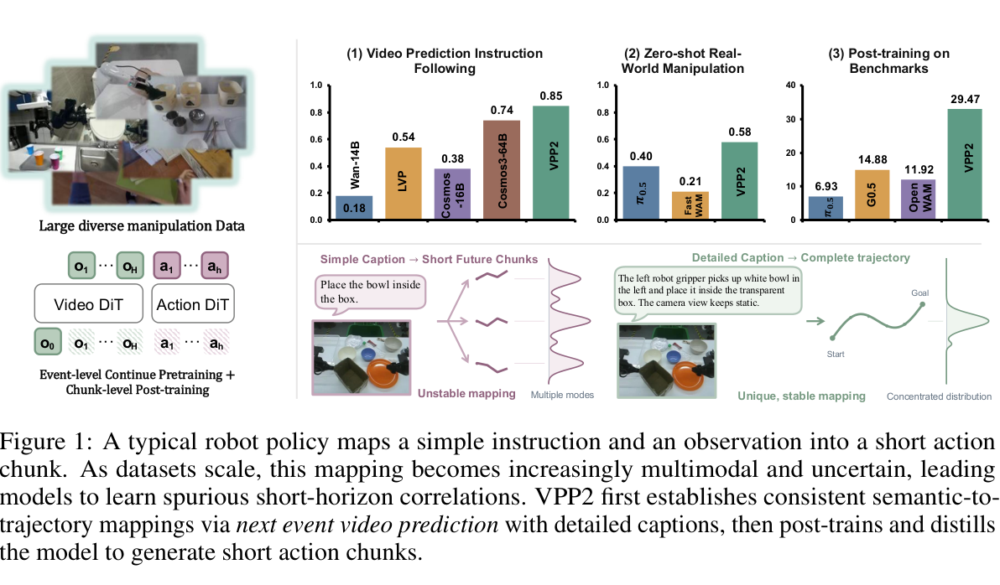

首页这张图在一页里干两件事：用三条结果给出「值得读下去」的业绩单，再把全文论点压成一张示意，说明简单指令到动作的映射是多峰的，而这正是模型规模变大以后仍然学到短视相关性的原因。

左侧是系统示意，操作数据先喂给 Video DiT，Action DiT 并行挂在旁边，下方标注着事件级续训加 chunk 级后训练。右上三张柱状图是三个结果维度，依次为视频预测指令遵循、真机零样本操作、基准后训练，前两张纵轴 0 到 1，第三张上限 40，都是柱子越高越好，每张最右边的绿柱是 VPP2。

右下两个并列示意要对着看。左半是简单 caption 配短未来片段，一条指令分叉成三条轨迹，密度曲线呈多峰；右半是详细 caption 配完整轨迹，只剩一条从 Start 到 Goal 的轨迹，密度曲线收成单峰。

三张柱状图的数字：指令遵循 VPP2 0.85，Cosmos3-64B 0.74、LVP 0.54、Cosmos-16B 0.38、Wan-14B 0.18；零样本真机 VPP2 0.58、π0.5 0.40、FastWAM 0.21；基准后训练 VPP2 29.47，G0.5 14.88、OpenWAM 11.92、π0.5 6.93。头一个 0.85 恰好是表 2 里人手 0.80 与机器人 0.90 的平均，可见这三张柱状图给的都是跨域平均值。

三个维度是作者自选的，没有误差棒也没有多次运行。第三张柱状图还有个更值得警惕的地方：它给 VPP2 标的是 29.47，而正文表 4 报的 RoboDojo 成功率是 32.26，图里的「G0.5 / 14.88」在表 4 的八个方法里根本查不到。首图没跟着正文一起更新，数字以表为准。右下那张是概念示意，不是测量结果，多峰收成单峰没有任何分布估计支撑。

## 三、数据处理：把「未来」变成唯一答案

数据来源分三类。机器人操作数据覆盖单臂（OXE、RoboMIND、DROID、RH20T 等）、双臂（AgiBot World-Beta、RoboCOIN、RDT、自采 ALOHA 等）和移动与人形（InternData-A1、Galaxea Open-World、自采灵巧手）。人类活动数据是 EgoDex、Ego4D、EPIC-KITCHENS、Something-Something V2 这类第一视角集合。

通用视频用 OpenVid 和 Panda-70M，按类似 LVP 的流水线筛出与操作相关的片段。完整清单在表 1，附录表 5 是它带文献引用的版本，两张都只交代来源，不承载结论。

流水线分三步。先剔除相机故障、画面突变等损坏轨迹；再把轨迹切成 1 到 12 秒的语义连贯片段，候选边界由启发式线索提议（人手或末端速度的局部极小、夹爪开合时刻），再交给一个视觉语言模型合并相邻片段、微调起止点；最后给每个片段生成详细 caption。附录把 caption 要消掉的歧义列成四类：任务过程描述、末端执行器身份、无歧义的目标物体指认、相机视角描述。

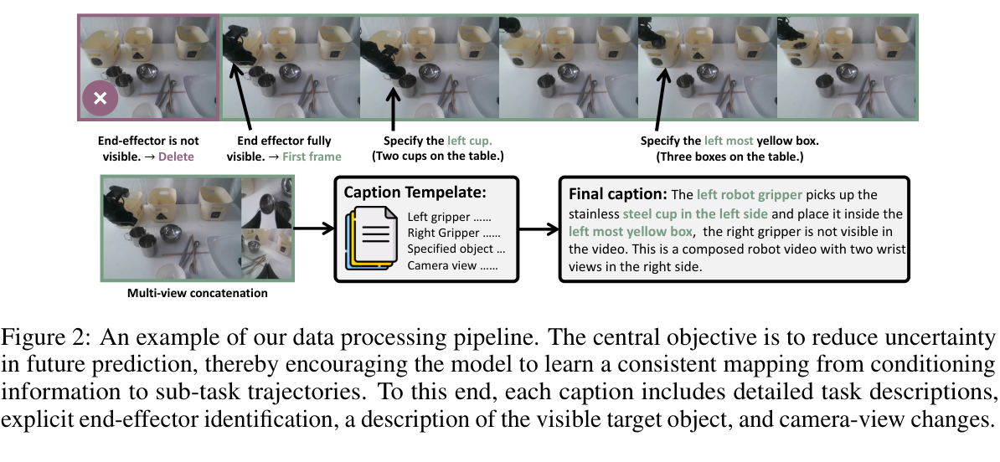

这张图只有一个人工挑选的样例，caption 的质量统计一概没给：平均长度、消歧覆盖率、VLM 标注错误率、人工复核比例全缺。它要担的事却不轻：详细 caption 听起来像一句口号，作者得让读者相信它是一条可执行、可规模化的流水线，否则第一创新点的前半截（条件信息足以确定未来）就落不了地。

上排是同一个片段的六帧。第一帧被紫框圈住并打了叉，标注「末端执行器不可见，删除」；第二帧标「末端完全可见，作为首帧」；其余为绿框。帧下方两条黑箭头指向两处消歧标注，一处写「指明是左边那个杯子（桌上有两个杯子）」，另一处写「指明是最左边那个黄盒子（桌上有三个盒子）」。

下排是流水线的后半段，从左到右为多视角拼成的 T 形图（主视图占左侧大块，右侧两个小窗竖排）、四行 caption 模板（左夹爪、右夹爪、指定物体、相机视角）、最终 caption。caption 里绿色高亮的词就是模板强制要求出现的消歧成分。这张图没有坐标轴，也谈不上哪个方向更好，要看的是模板那四行有没有被真的填满。

图里能看出三件 caption 文本里看不出的事。送进模型的首帧是末端首次完全可见的那一帧，原视频开头那一段会被直接裁掉。消歧靠的是空间关系而不是类别名，写的是 left cup、left most yellow box，因为桌面上存在同类物体。最终 caption 连「右夹爪在本视频中不可见」和「这是一个右侧带两个腕部视角的合成视频」都写了进去，等于把观测的拼接方式也变成了条件的一部分。

caption 由 VLM 生成，一条错 caption 会把「唯一映射」变成「唯一的错误映射」，这类噪声的量级论文没有报告。模板也是为双臂夹爪写的，人手和灵巧手数据怎么填那四行，图里看不出来。

接下来是动作侧的对齐。不同数据集的坐标系和视角互不一致，视觉上相同的动作会对应冲突的标注：向左移动在一个数据集里是 +x，在另一个里是 -y。作者把范围收在以自我为中心的双臂数据（ALOHA 式、人形、人类第一视角），这部分占全部数据八成以上，结构和视角本来就接近。

对齐分两级。工作空间对齐 $A_d$ 作用在世界系，让不同机器人的可达空间可比；末端对齐 $B_d$ 作用在局部，统一末端原点与轴向。原始位姿 $T_d$ 对齐后写成 $\tilde{T}_d = A_d T_d B_d$（附录的式 6），$A_d$ 把各数据集的世界系搬到约定的标准世界系，$B_d$ 把原生末端系转到标准末端系。

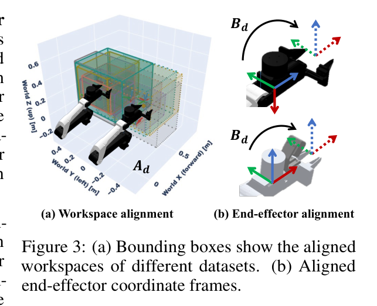

对齐这件事有两个前提：跨数据集的动作标注确实互相冲突，而两级刚体变换确实能把冲突压掉。没有图，这两条读者只能靠想象。

子图 (a) 画工作空间对齐。这是一张三维示意，三个轴是 World X（forward）、World Y（left）、World Z（up），单位是米，范围大致在 -0.4 到 0.6 之间；若干颜色不同的线框立方体是各数据集自己的末端工作空间包围盒，标 $A_d$ 的变换把它们搬进同一个世界系。

子图 (b) 画末端对齐，上下各一种末端形态。实线 RGB 三轴是数据集原生的末端坐标系，虚线 RGB 三轴是对齐后的标准轴向，$B_d$ 的弧形箭头就是这个局部旋转。两个子图都没有越高越好的量，要看的是框是否落进同一区域、轴是否指向同一方向。

(a) 里几个包围盒对齐后明显重叠，但大小和位置并不相同，这正说明对齐的目标是可比而非相同：不同机器人的臂长和工作台高度本来就不同。(b) 里两种外形差别很大的末端被旋转到同一套轴向，于是「夹爪朝前」这类语义对两类数据成了同一个方向。

两个子图都是定性的，既没有对齐残差，也没有「不对齐 vs 对齐」各训一遍的对照，这条设计究竟值多少成功率，全文无法回答。(a) 里没有图例说明哪个颜色对应哪个数据集，读者连覆盖了几个数据集都数不出来。剩下那不到两成的非自我中心或单臂数据怎么进训练，论文也没交代。

输入侧最后统一了一下：多相机观测排成 T 形合成图，主视图在左，两个辅视图竖排在右，辅视图不足两个时用纯黑占位图补齐。这个细节在图 5 里能直接看到。

## 四、VPP2：一个具备零样本能力的通用策略

底座是 Wan2.1-I2V-14B，动作专家以 MoT 架构挂在上面。训练目标分两步：先把视频模型改造成能在开放任务上做实时未来预测的模型，再在它的 KV cache 条件上训练动作专家。三个阶段的分工就是下一节那张流水线图。

### 4.1 视频预测模型的训练流程

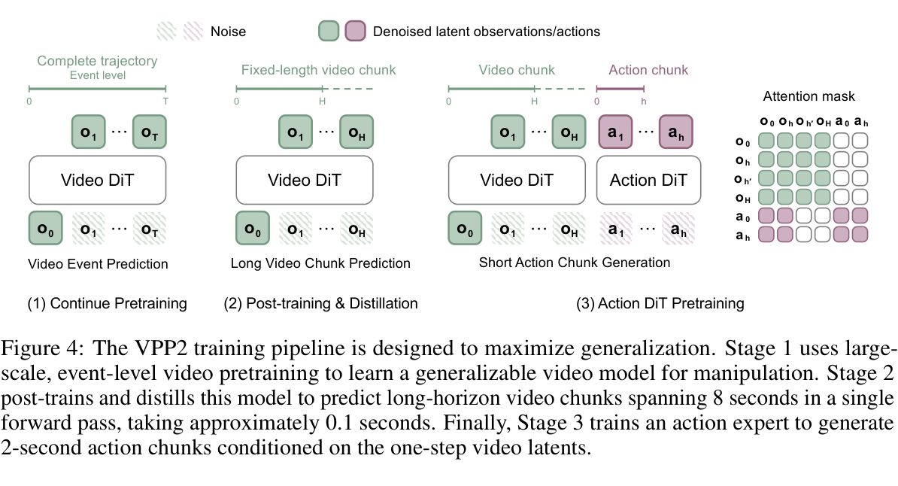

引言里第二条病因是动作训练会把视频模型的泛化训掉。这张图是全文对它给出的唯一一处直接解法，顺带也交代了三个阶段各自预测什么。

左中右三栏是三个阶段，依次为 Continue Pretraining、Post-training & Distillation、Action DiT Pretraining。每栏结构相同，下排是输入，中间是模块（Video DiT / Action DiT），上排是输出。顶部图例给出配色约定：斜纹块是噪声，实心块是去噪后的 latent，绿色属于观测，紫红属于动作；$o_0$ 在三栏里都是实心绿，因为它是已知的条件帧。

每栏上方的时间轴标出预测范围：阶段 1 是 $0 \to T$ 的完整轨迹（标注 Event level），阶段 2 是 $0 \to H$ 的定长视频 chunk，阶段 3 在视频 chunk 之外多出一条 $0 \to h$ 的动作 chunk，且 $h < H$。最右边单独一块是 6×6 的注意力掩码，行是 query、列是 key，顺序都是 $o_0, o_h, o_{h'}, o_H, a_0, a_h$，填色表示可见，留白表示被屏蔽。这块掩码不比大小，也没有哪个方向更好，要看的是哪几格填了色。

四个视频行在四个视频列上全部填绿，在两个动作列上整片留白：视频 token 完全看不到动作 token，动作训练的梯度不会经注意力回流去改写视频表示。两个动作行在 $o_0$ 和 $o_h$ 上填色、在 $o_{h'}$ 和 $o_H$ 上留白，同时对两个动作列填色，于是动作只读取与它自己时间范围重叠的那段视频 latent，更远的未来对它不可见。配上时间轴就是：视频侧预测 8 秒的 chunk，动作侧只生成 2 秒的 chunk，单次前向约 0.1 秒。这条单向可见的设计，是整篇论文对「动作学习会损害视频泛化」给出的结构性回答。

不过这只是结构声明。掩码的单向性究竟保住了多少泛化，全文没有放开掩码再测一遍的对照。$h$ 与 $H$ 在图里只有符号，取值要回正文找（人手 2 秒、机器人 8 秒），$o_{h'}$ 代表哪一层的中间 latent 也没说明。阶段 2 把后训练和蒸馏画在同一栏里，它们其实是两个损失、两段训练，图上看不出先后顺序和各自的训练量。

阶段 1 是事件级续训。给定一条演示 $\tau = (o_0, o_1, \dots, o_T)$，在整段事件上均匀取 $N$ 帧作为预测目标：

$$y_{\text{event}} = \left(o_0,\ o_{\lfloor T/N \rfloor},\ o_{\lfloor 2T/N \rfloor},\ \dots,\ o_T\right)$$

$T$ 是事件最后一帧的下标，$N$ 是未来帧数（不含条件帧 $o_0$）。分母是 $T$ 这一点管着全部效果：无论这个子任务实际花了多久，预测目标永远是「从头到尾走完它」。这就是第一创新点的全部数学内容，它把采样的锚点从绝对时间换成了事件进度。

取 $x_1 = E(y_{\text{event}})$ 为视频 latent（$E$ 是视频编码器），按 $x_s = (1-s)\epsilon + s x_1$ 在噪声与数据之间插值（式 2，$s=0$ 是噪声、$s=1$ 是数据），再用标准的 flow matching 目标 $\mathcal{L}_{\text{FM}}(\theta) = \mathbb{E}\left[\|v_\theta(x_s,s,c) - (x_1-\epsilon)\|_2^2\right]$ 训练（式 3）。模型学的是从噪声指向数据的速度场，条件 $c$ 是子任务指令加首帧 $o_0$。

这一阶段预测 49 帧、分辨率 416×240，在 Wan2.1-I2V-14B 上续训 30000 步，batch size 1024，学习率 1e-5。

阶段 2 做定长 chunk 后训练加一致性蒸馏。事件级采样有个副作用：事件时长不同，相邻预测帧之间的真实时间间隔也就不同，没法和定长动作 chunk 对齐。所以再后训练一次，把目标换成固定时长，取间隔 $\delta = fH/N$（$H$ 是以秒计的预测时长，$f$ 是帧率），从第 $t$ 帧起采 $(o_t, o_{t+\lfloor\delta\rfloor}, \dots, o_{t+\lfloor N\delta\rfloor})$（式 4），损失仍是式 3，人手取 2 秒、机器人取 8 秒。接着做一致性蒸馏：

$$\mathcal{L}_{\text{CD}} = \mathbb{E}\left[\lambda(s,s')\left\|F_\theta(x_s,s,c) - \mathrm{stopgrad}\left(F_{\bar{\theta}}(\hat{x}_{s'},s',c)\right)\right\|_2^2\right]$$

$F$ 是「直接跳到终点」的预测器而不是速度场，$0 \le s < s' \le 1$ 是两个流时刻，$\hat{x}_{s'}$ 由冻结的教师从 $(x_s,s)$ 积分到 $s'$ 得到，$\bar{\theta}$ 是学生参数的 EMA。这条损失要求同一条流轨迹上相邻两个噪声水平给出的终点预测一致；一致性成立，从纯噪声一步跳到终点才成立。为了把能力压到单步，作者以 0.5 的概率直接取 $s'=1$。推理时就是一次前向 $F_\theta(\epsilon, 0, c)$。

### 4.2 动作建模：让动作看得见视频、视频看不见动作

动作专家是一个 0.9B 参数的 DiT，以标准 MoT 方式与视频 DiT 并行。因为它是新初始化的，动作训练早期会冻结视频 DiT 的基础参数，视频骨干只通过 LoRA 适配，目的是保住预训练的视频表征、限制动作梯度的扰动。配上 4.1 那张掩码图，保护视频先验在这里有两道防线：注意力层面视频看不到动作，参数层面视频骨干基本不动。

延迟账也在这一节。后训练时视频输入降到 17×416×240，加上单步蒸馏，bfloat16 配 torch.compile 下视频部分约 0.12 秒；动作专家在视频 latent 条件上做五步去噪，约 0.1 秒；每条动作 chunk 合计约 0.22 秒。按 2 秒的动作 chunk 算，这个开销留出了足够的闭环余量。

### 4.3 用 VLM 做高层规划

长程任务和含糊的人类指令交给一个 VLM，由它负责高层推理、语义理解和记忆，把开放式指令翻成明确的子任务指令，VPP2 只管「明确指令到轨迹」这一段。动机和第一创新点是同一个：让策略面对的条件分布尽量保持单峰。这个 VLM 可以本地部署，也可以调用前沿模型的 API。

还有一个被作者一句话带过、却会影响复现的设计：VLM 同时把子任务描述写成与训练 caption 模板同构的详细形式，论文称为 prompt enhancement。训练用详细 caption、测试只给一句短指令，本来会造成条件分布错配，这一步把错配补上。但论文没有任何实验衡量它值多少，也没说后面哪些结果用了它，所以对照表里这一条只能挂在作者的陈述上。

## 五、实验

实验按三个问题组织：VPP2 的视频预测在操作任务上，运动质量比得过最强的视频基座模型吗？它的零样本操作能力有多宽？针对具体领域后训练之后能做到什么水平？第一个问题归 4.1，后两个归 4.2。

### 5.1 视频预测质量分析

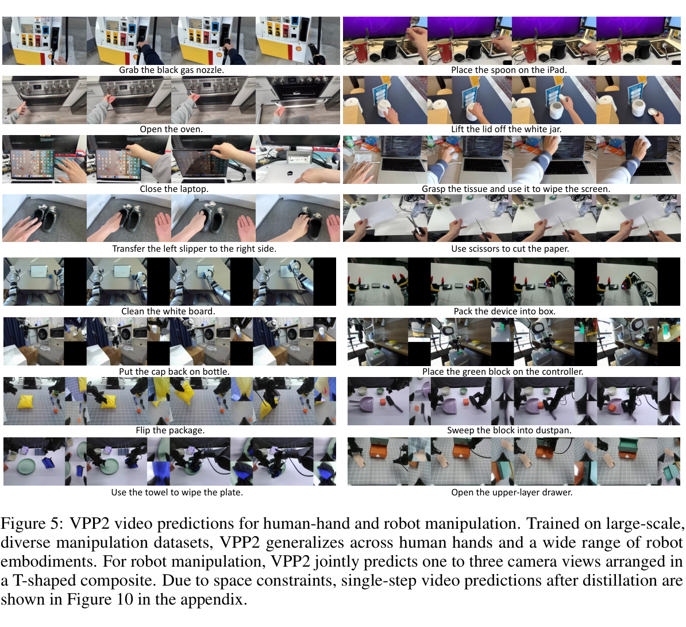

这 16 个案例全是作者挑出来的成功样例，没有失败案例、没有成功率，也没有把真实未来帧并排放上来作对照，预测得对不对只能靠读者目测。它承担的也只是一道定性门槛：预训练后的视频模型面对从没见过的环境和随手写的指令，还能不能画出一段合理的操作过程。量化结论要等下一节。

16 个案例排成 8 行 2 列，每个案例横向是时间上的 4 帧，指令写在案例下方。上面 4 行（8 个案例）是人手第一视角数据，下面 4 行是机器人数据，机器人案例的每一帧都是 T 形合成图，左边大块是主视图，右侧竖排一到两个辅视角。这张图不给分数，也没有越高越好的轴，要看的是指令里点名的那个物体是否真的被操作、4 帧之间的动作是否连贯。

图里有三件 caption 没写的事。T 形布局和黑色占位图是真的，"Clean the white board" 和 "Put the cap back on bottle" 这两个案例的右侧明显是纯黑小窗，正对应正文说的辅视角不足时补黑图。任务本体是日常长尾而不是桌面抓放，加油枪、烤箱门、剪纸、合笔记本电脑、把积木扫进簸箕都在里面。测试样例是作者在办公环境和机器人工位现场拍照、再配自由撰写的指令，训练数据跨越 20 多种机器人形态。

每个案例只展示 4 帧，而这一阶段模型实际预测 49 帧，中间是否出现物体闪现、手穿过物体之类的破绽完全看不到。还要注意这是预训练模型（多步采样）的结果，真正上机的单步蒸馏模型要到图 10 才出现。

定量部分的对手是四个视频基座模型加一个消融变体：底座 Wan-2.1-I2V-14B-480p；同样把这个底座适配到操作任务的 LVP；在机器人操作数据上大量训练过的 Cosmos3-Nano-16B；Cosmos 3 家族最强的 Cosmos3-Super-Image2Video-64B；以及 VPP2-Fixed-Step，把事件级采样换成定长采样的自家消融。人手和机器人各随机收集 50 对图像与指令，每个模型都生成预测。

这张表同时回答两件事：VPP2 的指令遵循是否真的超过更大的视频基座模型，以及这份优势是否来自事件级采样。第二件事只靠 `VPP2-Fixed-Step` 这一行，它是全篇唯一的单变量切除实验。

两列 Human / Robot 是人手和机器人两个评测域，数值是 GPT 评判器判定的指令遵循成功率，取值 0 到 1，越高越好。前四行是外部基线，第五行是自家消融，第六行加粗的是完整 VPP2。

表 2 里完整 VPP2 是 0.80 / 0.90，Cosmos3-64B 是 0.70 / 0.78，领先 10 和 12 个百分点，而 VPP2 是 14B、对手是 64B。消融那一行更说明问题：VPP2-Fixed-Step 只有 0.48 / 0.42，比完整版低 32 和 48 个百分点，人手域上甚至低于 LVP 的 0.62。底座 Wan2.1-14B 是 0.32 / 0.04，续训的净提升是 48 和 86 个百分点，机器人域上底座几乎不可用。

成功率由 GPT 评判器判定，论文没有给出它与人工判定的一致性检验，评判 prompt 也未公开。每域 50 对、单次运行、无置信区间，0.90 与 0.78 之间的差距落到样本上只有 6 个样例，这个量级的差异经不起重复实验。消融变体是否从同一 checkpoint 出发、训练步数是否相同，论文没有交代；若不同，那这一行隔离的就不只是采样方式。消融还只在指令遵循这一个指标上做，事件级采样对下游动作成功率的影响始终没有被测量。

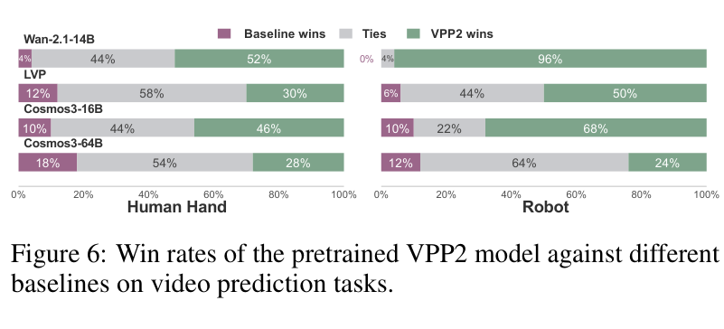

GPT 评判器给的是自动指标，作者还需要人类评委的两两对比来交叉验证同一个主张：预训练阶段的视频预测能力本身就已经超过现有视频模型。否则后面的动作性能提升全都可以记在后训练账上。

图 6 分两个子图，左边 Human Hand，右边 Robot。每一行是一个对手，标签写在横条左上方，依次为 Wan-2.1-14B、LVP、Cosmos3-16B、Cosmos3-64B。横条从左到右三段是 Baseline wins（紫）、Ties（浅灰）、VPP2 wins（绿），横轴是占比 0% 到 100%，最右侧绿色段越长越好。

对底座 Wan-2.1-14B，人手域 VPP2 胜 52%、对手 4%，差 48 个百分点，机器人域拉大到 96% 对 0%。但对最强的 Cosmos3-64B，人手域只有 28% 对 18%，领先 10 个百分点，平局占 54%；机器人域 24% 对 12%，领先 12 个百分点，平局占 64%。中间两个对手是 LVP（人手 30% 对 12%，机器人 50% 对 6%）和 Cosmos3-16B（人手 46% 对 10%，机器人 68% 对 10%）。胜率的难易排序和表 2 的成功率排序一致，LVP 与 Cosmos3-64B 是两个最难赢的对手。

胜率是两两相对指标，不能跨行相加，也不能把两个子图并起来算。对 Cosmos3-64B 的平局率高到 54% 和 64%，意味着多数情况下人类评委分辨不出差别，这和表 2 里 0.80 对 0.70 给人的「干净领先」印象差得不少。图里没有交代评委几人、是否盲评、是否与作者无关，也没有评委间一致性；每行同样是 50 对比较、单次运行、没有误差棒。

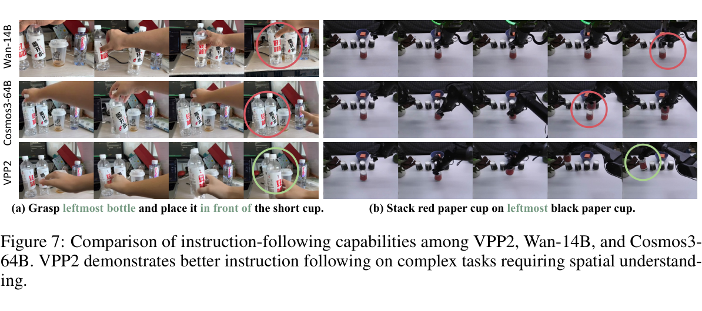

红绿圈是作者自己标的，「做错了」的判据没有独立依据，读者也无从核对；案例只有两个。在这个前提下看它想说明什么：正文把优势归给「需要空间理解的复杂操作场景」，而指令里 leftmost、in front of 这类空间限定词到底有没有被遵守，只有图能摆出来。

三行两列。行是三个模型（Wan-14B / Cosmos3-64B / VPP2，标签竖排在最左侧），列是两个案例，(a) 抓最左边的瓶子并放到矮杯前面，(b) 把红纸杯叠到最左边的黑纸杯上，指令里的空间限定词被标成绿色。每个单元格给 4 帧。作者已经把结论画在图上了，红圈表示这一步做错，绿圈表示做对，所以读图其实是看末帧圈的颜色和它圈住的内容，绿圈越多越好。

(a) 里 Wan-14B 的末帧红圈落在被挪动的瓶子上，Cosmos3-64B 的末帧红圈也在瓶子区域，只有 VPP2 的末帧是绿圈。(b) 里 Wan-14B 末帧被标红，Cosmos3-64B 在第 3 帧就被标红，VPP2 末帧为绿圈。两个案例的共同点是都要在同类物体中按空间关系挑出一个（最左的瓶子、最左的黑杯），而这正是图 2 里 caption 流水线专门消歧的那一类歧义，数据侧的设计和这里的定性结果对得上。

没有真实未来帧作对照，仍然只给 4 帧，中间过程不可见。更根本的是，这张图支撑不了「空间理解类任务上优势最明显」这种比较性结论，那需要按任务类型分层的成功率，论文没有给。

附录 B 里还有一组对照。前面所有视频预测结果都来自多步采样的模型，真正部署的却是蒸馏后的单步模型，这组图是两者之间唯一的桥。

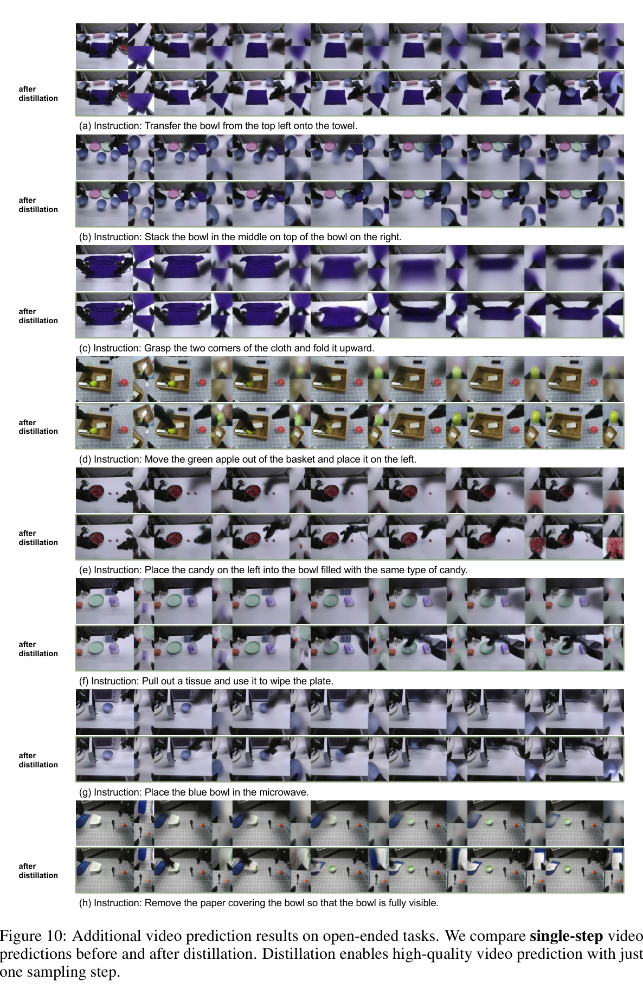

上机运行的模型是单步生成的，所以这里要回答的是：把采样压到一步之后，画质还剩多少。这张图是一致性蒸馏这条创新点唯一的直接对照。

8 个案例标为 (a) 到 (h)，每个案例两行，上行是蒸馏前的单步预测，下行标着 after distillation，是蒸馏后的单步预测；每行横向是 8 个时间步的 T 形合成帧，指令写在案例下方。这里没有越高越好的轴，该比的是上下两行的同一列；行内从左到右只是时间推进。

上下差别大到不需要指标。蒸馏前的单步结果普遍退化成紫灰色糊状，(a) 里毛巾和碗融成一片蓝紫色块，(c) 里被折叠的布完全失去边缘，(e) 和 (g) 里物体身份直接消失。蒸馏后在同样一步的预算下，夹爪、碗、苹果、糖果在 8 个时间步里都保持可辨，(d) 里绿苹果被移出筐子再放到左侧的过程可以逐帧跟下来。一致性蒸馏在这里不是略微提速，它是单步这个工作点能否成立的前提。

这组对比的基准线对自己有利：蒸馏前单步本来就不是教师模型该用的配置，它的正常工作点是多步采样。图里没有「蒸馏前多步」那一行，所以它证明的是要单步就必须蒸馏，而非蒸馏后的质量追上了教师。全图没有任何量化指标，没有 FVD 也没有 PSNR，没有失败案例，8 个案例同样是作者挑的。

### 5.2 策略性能分析

这一节分三块：真机零样本、LIBERO 三档泛化、RoboDojo 基准，最后加上子任务规划的增量。

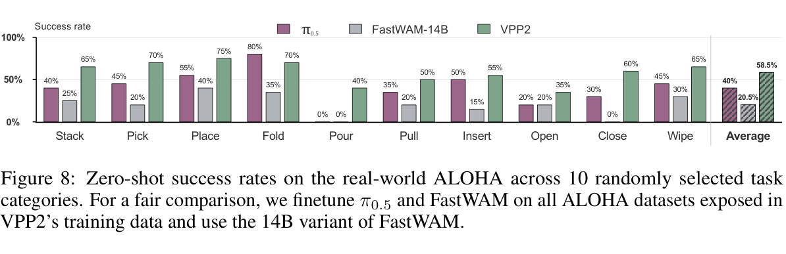

图上所有数值都是 5 的整数倍，说明每类大约只有 20 次试验，而且是单次运行、没有误差棒。这个粒度决定了下面的数字能读到多细。图本身回答的是零样本的宽度：在训练中见过的机体上、不针对任务做任何微调，VPP2 能覆盖多少种操作。

图 8 的横轴是 10 个任务类别，最右侧用竖线隔开的是 Average（斜纹柱）。每组三根柱，π0.5（紫）、FastWAM-14B（灰）、VPP2（绿），纵轴是成功率，从 0% 到 100%，越高越好，柱顶都标了数值。为了可比，两个基线在 VPP2 训练数据里出现过的全部 ALOHA 数据上微调过，FastWAM 用的是 14B 版本。

图 8 的平均成功率依次是 58.5%、40.0%、20.5%，VPP2 领先更强的那个基线 18.5 个百分点。10 类里 VPP2 在 9 类最高，唯一输掉的是 Fold，π0.5 的 80% 对 VPP2 的 70%。两个基线同时为 0% 的 Pour，VPP2 拿到 40%；Close 上 FastWAM 为 0%、VPP2 为 60%。VPP2 自己最弱的是 Open（35%）和 Pour（40%），都属于需要精细接触或连续受力控制的动作。

一次成败就值 5 个百分点，35% 与 40% 之间的差别因此不具备判别力。Average 是 10 个类别的未加权平均，而类别本身是「随机选取」的，论文没说从多大的池子里选。零样本的口径也要留意：VPP2 部署在训练中见过的机体上，两个基线则在 ALOHA 数据上微调过，三者的参数量、训练数据暴露和推理预算都不相同，这一列数字并非同等条件下得到的。

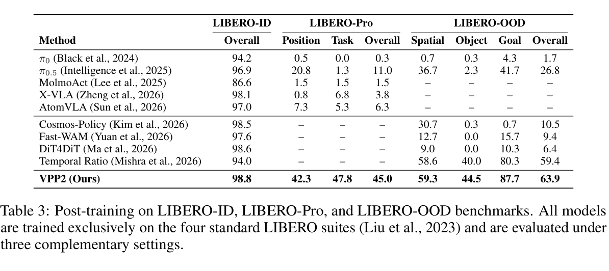

全文最关键的量化论点由这张表立住：在标准 LIBERO 上刷到接近满分的策略，一旦任务配置被扰动或被重新组合就会崩掉，而 VPP2 不会。

三组列分别是 LIBERO-ID（Overall）、LIBERO-Pro（Position / Task / Overall）、LIBERO-OOD（Spatial / Object / Goal / Overall），数值是成功率百分数，越高越好，`–` 表示该方法没有这项结果。上面五行是 VLA 基线，中间四行是基于视频的策略，底部加粗行是 VPP2。所有模型都只在四个标准 LIBERO 套件上训练，Pro 和 OOD 不做额外训练。

LIBERO-ID 一列里除 MolmoAct（86.6）外全部挤在 94 以上，VPP2 98.8、DiT4DiT 98.6、Cosmos-Policy 98.5，几乎没有区分度。换到 LIBERO-Pro，最强基线 π0.5 掉到 11.0，VPP2 是 45.0，差 34 个百分点；Task 扰动那一列最极端，VPP2 47.8，X-VLA 6.8，π0.5 1.3。

LIBERO-OOD 上，同样基于视频的 Cosmos-Policy、Fast-WAM、DiT4DiT 最高只到 10.5，VPP2 是 63.9；唯一同量级的对手是专门针对这个泛化缺口的 Temporal Ratio，59.4，但它的 LIBERO-ID 只有 94.0。附录表 6 把 LIBERO-ID 拆成四个套件，VPP2 为 99.2 / 99.8 / 98.2 / 98.0，与第一列的结论一致。

满表的 `–` 说明这是一张拼接表，基线数字取自各自原论文以及 Zhang et al. 2026d 和 Mishra et al. 2026，训练细节、评测种子、每个任务的 episode 数都不保证一致，跨行逐格比较有风险。表里没有报告评测 episode 数、种子数和方差，而 LIBERO 这类基准的单次评测波动并不小。叙述上也有夸大：Temporal Ratio 在 OOD 上 59.4 对 VPP2 的 63.9，只差 4.5 个百分点，把它和「视频类策略最高 10.5」并列讲，会让读者高估 VPP2 的领先幅度。

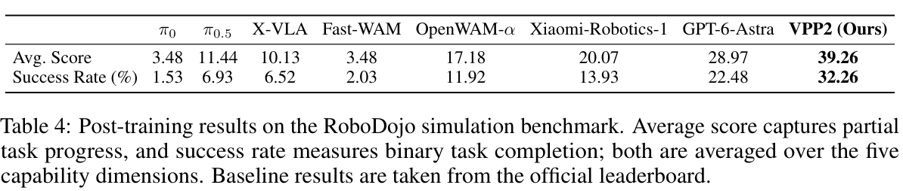

针对领域后训练之后能做到什么水平，答案就是这张表，论文的 SOTA 声明也出自这里。

两行指标，Avg. Score 衡量部分任务进度，Success Rate 衡量二值完成；八列是方法，加粗的是 VPP2。两个指标都是五个能力维度上的平均，越高越好，基线取自官方榜单。

榜首是 VPP2，平均分 39.26、成功率 32.26%。第二名是前沿基础模型 GPT-6-Astra 的 28.97 / 22.48%，成功率差 9.78 个百分点；对 π0.5 的 6.93% 和 Fast-WAM 的 2.03% 则是数量级差别。Fast-WAM 作为同类 WAM 只有 2.03%，这与表 3 里视频类策略在 OOD 上集体崩盘是同一个现象。

基线是 2026 年 9 月的官方榜单快照，与 VPP2 自测的评测版本、episode 数是否一致无从核对，每个数字也都只有一次运行、没有方差。更要紧的是这两行把五个能力维度压成一个平均数，掩盖了维度之间的巨大落差，下面那张附录表才看得出来。

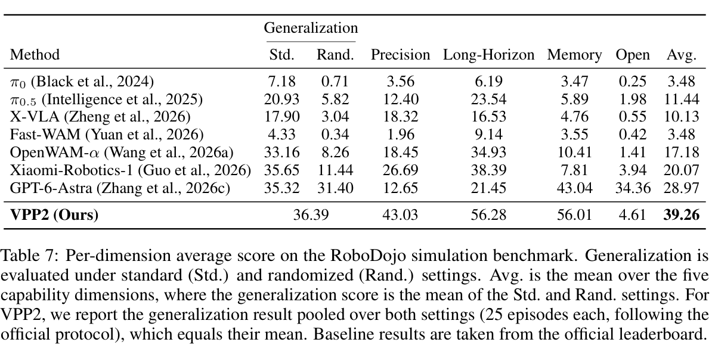

表 4 只给平均分，看不出这个 SOTA 是全面领先，还是几个维度上的大幅领先掩盖了另一个维度上的塌陷。这张附录表能看出来。

列是五个能力维度：Generalization（分 Std. 与 Rand. 两个设置）、Precision、Long-Horizon、Memory、Open（开放词表指令遵循），最后 Avg. 是五维均值，其中 Generalization 取两个设置的平均，越高越好。VPP2 那一行的 Generalization 只有一个数字，跨在两列之间，因为作者按官方协议把两个设置合并评测（各 25 个 episode），合并值等于两者均值。

VPP2 的领先集中在三项，Precision 43.03、Long-Horizon 56.28、Memory 56.01，分别高过第二名 Xiaomi-Robotics-1 的 26.69、38.39 和 GPT-6-Astra 的 43.04。

可是 Open 这一维 VPP2 只有 4.61 分，GPT-6-Astra 是 34.36 分，低 29.75 分；表 8 的成功率版本结构相同，VPP2 的 Open 是 4.08、GPT-6-Astra 是 31.00。VPP2 的总分优势来自精度、长程和记忆，不来自开放词表的指令理解。

VPP2 的 Generalization 用了与基线不同的评测口径（合并 Std./Rand.），严格说这一列不能和基线逐格对齐，而 25 个 episode 的样本量很小。那 4.61 分更值得追问：全文反复强调 VPP2 的指令遵循更好，而 RoboDojo 的 Open 维度测的恰恰是未见过的任务说明下的指令执行，两处的「指令遵循」并不是同一件事，前者在视频预测层面，后者在策略层面。论文没有讨论这个落差，也没有解释为什么一个以指令对齐为卖点的模型会在这一维上几乎为零。

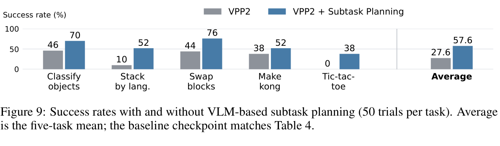

表 4 的主结果用的是完整任务指令、不带规划。这张图给的是加上 VLM 子任务规划之后的增量，也是 4.3 节那套分层设计唯一的实验支撑。

可惜这不是干净的开关实验。正文说子任务条件策略是另外切分演示数据重新训练的，于是训练数据的粒度和测试时有没有 VLM 这两个变量同时变了，那 30 个百分点不能全部记到 VLM 头上。五个任务组是从 42 个任务里挑出来的，而表 4 的主结果并未使用规划，所以这张图的增益不能叠加到 32.26% 上。

图 9 的横轴是五个任务组（物体分类 / 语言条件码垛 / 交换积木 / 做杠 / 井字棋），最右侧用竖线隔开的是 Average。每组两根柱，灰色是 VPP2，蓝色是 VPP2 + Subtask Planning，纵轴是成功率百分数，越高越好，柱顶标了数值。每个任务 50 次试验、单次运行、无误差棒，论文也没说用的是哪个 VLM。

图 9 的平均一栏是 57.6% 对 27.6%，提升 30 个百分点。最大增益在语言条件码垛，10% 到 52%，即 42 个百分点，其次是井字棋的 0% 到 38%。其余三组是物体分类 46% 到 70%、交换积木 44% 到 76%、做杠 38% 到 52%。井字棋那组最说明问题：不加规划是 0%，这类需要多步决策的任务对单层策略是完全不可解的，而不只是做得差一些。

## 六、相关工作

视频基座模型这边，论文的立足点是大规模双向视频模型提供了最强的通用视频先验，连近期的自回归生成器都要拿预训练的双向模型做初始化或教师。这正是 VPP2 先学一个泛化的视频模型、再把它改造成高效预测器的理由；prompt enhancement 也是从这条线借来的做法，只是换成了面向操作的详细描述。

世界动作模型这边，早期工作先生成未来帧再用逆动力学反推动作，但迭代式视频生成的延迟撑不起闭环控制；较新的做法改为把动作条件化在视频模型的特征上，或者让视觉预测与动作生成联合训练。论文真正要跟整条线划清界限的是一句被反复引用的发现：动作学习会损害预训练能力，既包括视频模型的泛化，也包括 VLM 的语义理解。从事件级预训练、详细 caption、定长后训练、单步蒸馏到带掩码的 MoT 动作专家，VPP2 的结构选择都围绕「别把视频先验训坏」这一条展开。

## 七、总结

这篇论文的做法压成一句话：把视频预测的目标从一小段未来换成一个完整的操作事件，让详细指令只对应一种未来，再把采样蒸馏到单步，动作专家用注意力掩码挂在视频 DiT 旁边、不回写视频表示。成绩是视频预测的指令遵循 0.85（图 1）、真机零样本平均 58.5%（图 8）、RoboDojo 成功率 32.26%（表 4）。作者的倡议值得带走：少花力气在动作建模的架构选择上，多花力气在学到可泛化的视频预测、并在动作学习中保住它。

证据的边界要一起记住。八处改动里只有事件级采样有干净的单变量消融（表 2），其余都是整条流水线一起测；「指令遵循更好」成立在视频预测层面，到了策略层面，RoboDojo 的开放词表维度 VPP2 只有 4.61 分、GPT-6-Astra 是 34.36 分（表 7）；所有数字都是单次运行，每项样本量在 20 到 50 之间，5 个百分点以内的差别读不出来。

真正稳的结论有两条。表 3 显示分布内接近满分与泛化几乎不相关，九个基线多数在 LIBERO-ID 超过 94，到 LIBERO-Pro 最高只有 11.0，这一条与 VPP2 本身的优劣无关。另一条是工程上的：定长 chunk 后训练加一致性蒸馏把视频侧压到约 0.12 秒、整条动作 chunk 约 0.22 秒，视频预测策略能不能实时这个长期疑问，基本被解决了。
